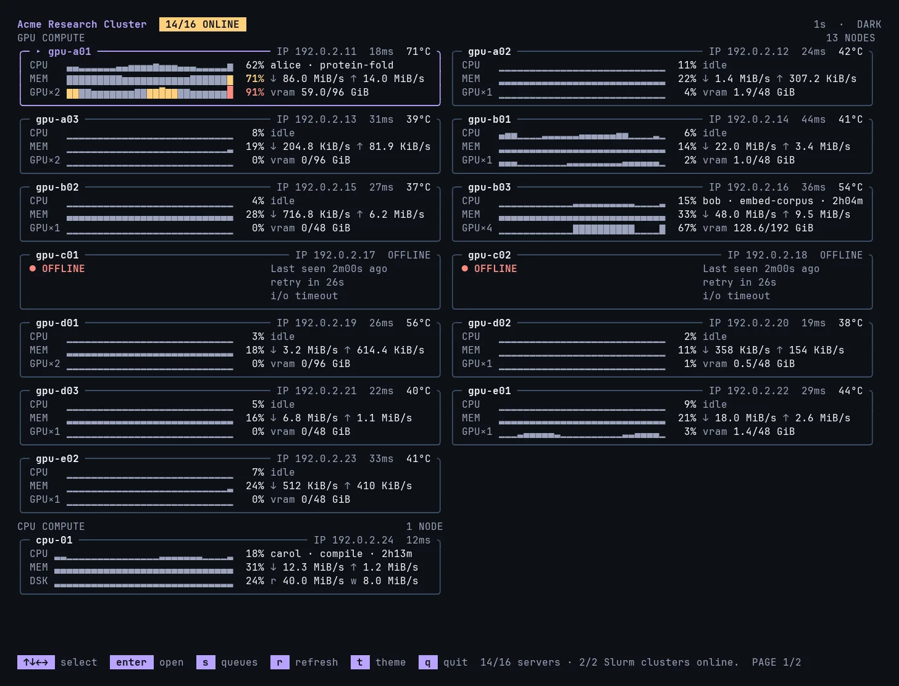
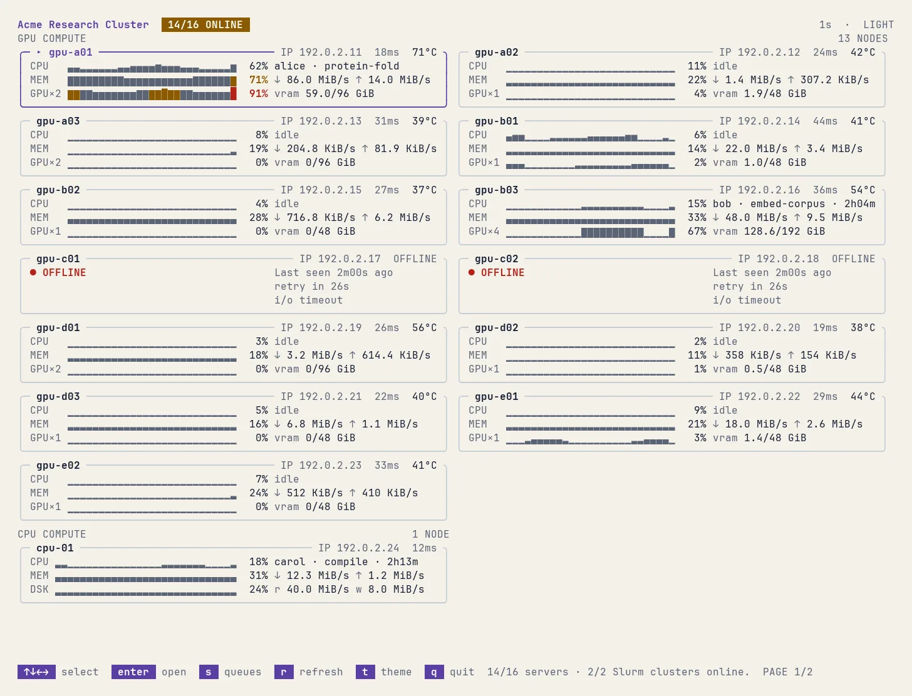
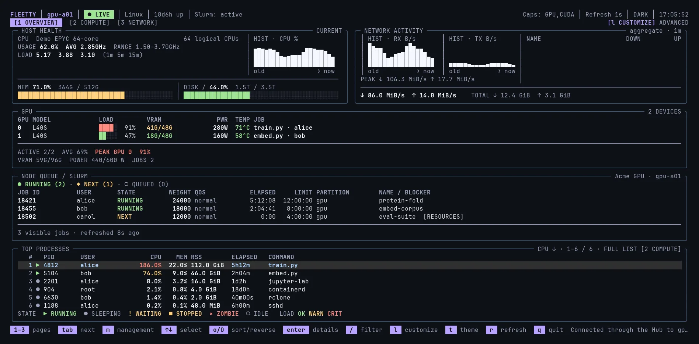
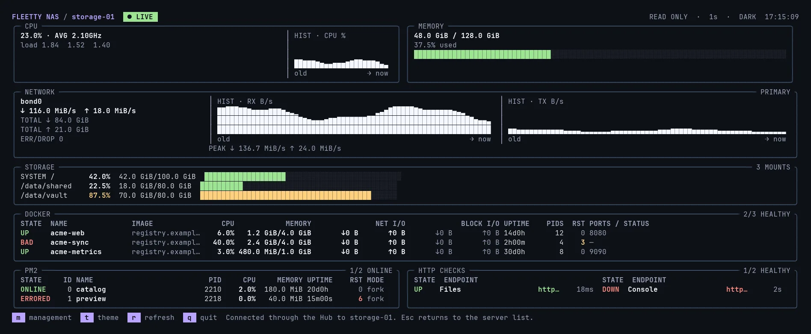

English | [简体中文](README.zh-CN.md)

<div align="center">

# Fleetty

Terminal monitor for local machines, GPU nodes, storage servers, and Slurm clusters over SSH.

[](https://github.com/Rhythmicc/Fleetty/actions/workflows/ci.yml)
[](https://github.com/Rhythmicc/Fleetty/releases/latest)
[](go.mod)
[](LICENSE)
[](https://goreportcard.com/report/github.com/Rhythmicc/fleetty)

</div>

<a href="docs/images/fleetty-hub.webp">
  
</a>

<table>
  <tr>
    <td width="50%" valign="top">
      <strong>Dark theme</strong> · press <code>t</code> to toggle<br><br>
      <a href="docs/images/fleetty-hub.webp">
        
      </a>
    </td>
    <td width="50%" valign="top">
      <strong>Light theme</strong> · follows terminal appearance<br><br>
      <a href="docs/images/fleetty-hub-light.webp">
        
      </a>
    </td>
  </tr>
  <tr>
    <td width="50%" valign="top">
      <strong>GPU node</strong> · GPUs, Slurm queue, processes<br><br>
      <a href="docs/images/fleetty-gpu.webp">
        
      </a>
    </td>
    <td width="50%" valign="top">
      <strong>Storage node</strong> · mounts, Docker, PM2, HTTP<br><br>
      <a href="docs/images/fleetty-nas.webp">
        
      </a>
    </td>
  </tr>
</table>

## Install

```bash
curl -fsSL https://raw.githubusercontent.com/Rhythmicc/Fleetty/main/install.sh | sh
```

See [Install and upgrade](docs/en/installation.md) for `go install`, [Releases](https://github.com/Rhythmicc/Fleetty/releases) binaries, and `FLEETTY_VERSION` / `FLEETTY_INSTALL_DIR`.

## Quick start

```bash
fleetty top                        # local monitor (Linux & macOS, no root)
ssh -p 23234 monitor@node.example  # remote SSH node
ssh -p 23235 monitor@hub.example   # multi-server Hub
```

To deploy a node or Hub on Linux, see [Install a Linux node](docs/en/installation.md#linux-ssh-nodes) and [Configure a Hub](docs/en/hub.md).

## Keybindings

| Key | Action |
| --- | --- |
| `1` / `2` / `3` / `4` | Overview / Compute / Network / Local Storage Map |
| `Tab` / `Shift+Tab` | Next / previous page |
| `↑` / `↓`, `Enter`, `Esc` | Select / open details or node / back |
| `/` / `c` | Filter processes / clear filter |
| `o` / `O` | Next sort column / reverse sort order |
| `l` / `m` / `t` | Layout editor / management mode / toggle dark & light theme |
| `s` / `r` / `q` | Slurm queue (on Hub) / refresh / quit |

## Documentation

- [Install and upgrade](docs/en/installation.md) — system requirements, `install.sh`, `go install`, Linux SSH nodes, `fleetty update`, uninstall
- [Using Fleetty](docs/en/usage.md) — pages, per-core CPU (`f` / `v`), network sockets, local storage map (`d` / `z` / `u`), custom layouts
- [Ghostty and themes](docs/en/themes.md) — automatic dark/light following, Ghostty palettes, Powerlevel10k colors
- [Hub](docs/en/hub.md) — `nodes.json` groups, persistent SSH RPC keys, multi-server navigation
- [Slurm](docs/en/slurm.md) — local and SSH login-node transports, `NEXT` candidates, QOS, compact queues
- [NAS and service checks](docs/en/nas.md) — `machine.json`, physical NICs, mounts, Docker, PM2, HTTP probes
- [Deployment](docs/en/deployment.md) — `fleettyctl`, fleet manifests, cascaded Hub rollouts, Prometheus & JSON export
- [Authentication and management](docs/en/security.md) — `ADMIN_PASSWORD_HASH`, read-only redaction, privileged helper socket
- [Configuration](docs/en/configuration.md) — user vs. system paths, environment variables, systemd logs, troubleshooting
- [Collection and performance](docs/en/performance.md) — sample intervals, connection reuse, 7-day `history.jsonl` retention

## Contributing

Issues and pull requests are welcome — see [CONTRIBUTING.md](CONTRIBUTING.md).

## License

[MIT](LICENSE)
