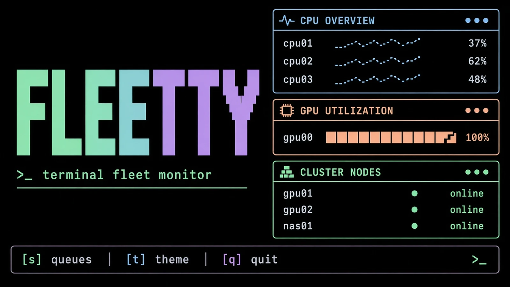
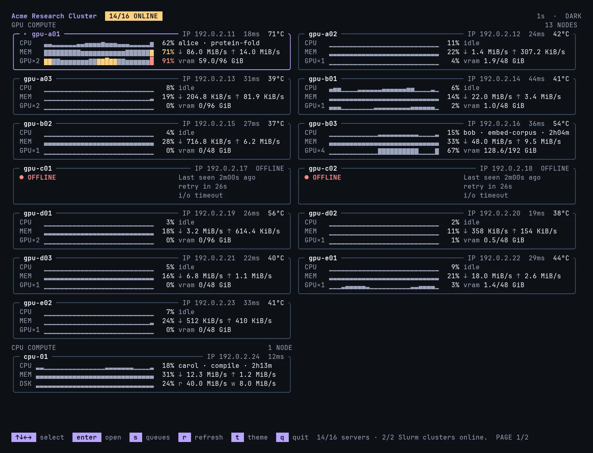
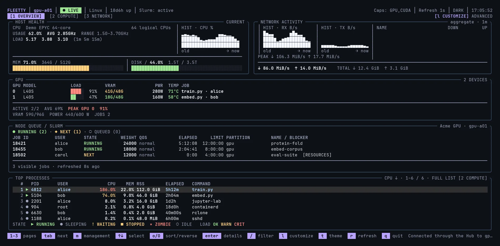
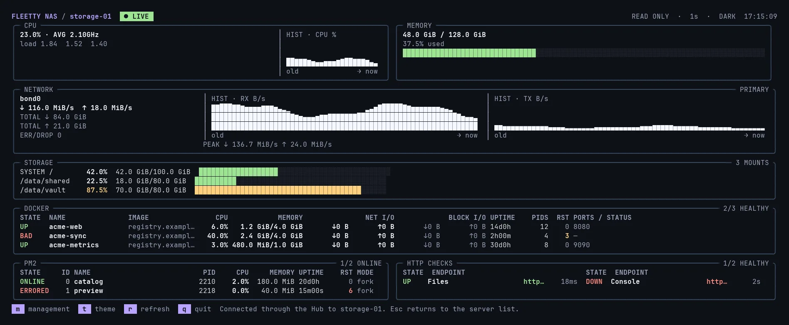

[English](README.md) | 简体中文

<div align="center">

# Fleetty

本地 top，以及面向主机、GPU、存储和 Slurm 的远程仪表盘。

[](https://github.com/Rhythmicc/Fleetty/actions/workflows/ci.yml)
[](https://github.com/Rhythmicc/Fleetty/releases/latest)
[](go.mod)
[](LICENSE)
[](https://goreportcard.com/report/github.com/Rhythmicc/fleetty)



</div>

Fleetty 是面向个人电脑、计算服务器、存储节点和 Slurm 集群的终端控制台。它既可以当作本地 `top`，也可以在专用 SSH 端口上提供远程仪表盘。这个端口不会开放系统 shell。只读监控与管理权限分开，每个会话各自保留布局和主题。

## 能做什么

- **本地 top。** Linux 和 macOS 上的 CPU、逐核负载、工作频率、内存、网络和进程。
- **GPU。** Linux 上的 NVIDIA，以及 Apple Silicon。只有机器确实能报出指标时才显示对应卡片。
- **Hub。** 在同一页查看多台机器的负载、温度、网络和地址，按键即可进入某一节点。
- **Slurm。** 同时查看多个集群、节点上的作业和下一份合资格候选。窄终端仍保留用户、已运行时间和作业名。
- **存储地图。** 在本机浏览占用、查重、压缩和删除。每次写操作都要明确确认。
- **服务。** NAS 挂载、Docker、PM2 和 HTTP 检查，以及安装器、健康检查和分层批量更新。

## 快速开始

### 本地监控

支持 Linux 和 macOS 的 `amd64`、`arm64`。下面的命令下载最新正式版、校验 SHA-256，并安装到当前用户目录：

```bash
case "$(uname -s):$(uname -m)" in
  Linux:x86_64)  fleetty_asset=fleetty_linux_amd64 ;;
  Linux:aarch64|Linux:arm64) fleetty_asset=fleetty_linux_arm64 ;;
  Darwin:x86_64) fleetty_asset=fleetty_darwin_amd64 ;;
  Darwin:arm64)  fleetty_asset=fleetty_darwin_arm64 ;;
  *) echo "Unsupported platform" >&2; exit 1 ;;
esac

fleetty_download_dir="$(mktemp -d)"
fleetty_release_base="https://github.com/Rhythmicc/Fleetty/releases/latest/download"
curl -fL "$fleetty_release_base/$fleetty_asset" -o "$fleetty_download_dir/$fleetty_asset" &&
curl -fL "$fleetty_release_base/checksums.txt" -o "$fleetty_download_dir/checksums.txt" &&
fleetty_expected="$(awk -v asset="$fleetty_asset" '$2 == asset { print $1 }' "$fleetty_download_dir/checksums.txt")" &&
if command -v sha256sum >/dev/null 2>&1; then
  fleetty_actual="$(sha256sum "$fleetty_download_dir/$fleetty_asset" | awk '{ print $1 }')"
else
  fleetty_actual="$(shasum -a 256 "$fleetty_download_dir/$fleetty_asset" | awk '{ print $1 }')"
fi &&
test -n "$fleetty_expected" && test "$fleetty_expected" = "$fleetty_actual" &&
mkdir -p "$HOME/.local/bin" &&
install -m 0755 "$fleetty_download_dir/$fleetty_asset" "$HOME/.local/bin/fleetty"
```

本地监控不需要 root，也不会监听网络端口：

```bash
"$HOME/.local/bin/fleetty" top
```

将 `~/.local/bin` 加入 `PATH` 后可直接使用 `fleetty top`。裸命令 `fleetty` 打开启动菜单。只有执行 `fleetty serve`，或在菜单里选择 SSH Server，才会启动远程服务。

### 远程节点与 Hub

按[安装 Linux 节点](docs/zh-CN/installation.md#linux-ssh-节点)登记客户端公钥并启动服务，再从客户端连接：

```bash
ssh -p 23234 monitor@node-host    # one node
ssh -p 23235 monitor@hub-host     # a Hub of many servers
```

SSH 用户名只用来标记会话，并不登录系统账户。服务只接受已登记的公钥。普通监控不需要管理密码；写操作另行认证。

- [安装 Linux 节点：普通用户或系统服务](docs/zh-CN/installation.md#linux-ssh-节点)
- [配置多服务器 Hub](docs/zh-CN/hub.md)
- [接入 Slurm 队列](docs/zh-CN/slurm.md)
- [由 Hub 分发更新，包括登录节点后面的计算节点](docs/zh-CN/deployment.md#由-hub-自动更新节点)

## Ghostty 与主题

我们建议使用 [Ghostty](https://ghostty.org/) 作为终端。仓库提供 [Fleetty Dark](themes/ghostty/Fleetty%20Dark) 和 [Fleetty Light](themes/ghostty/Fleetty%20Light)：炭黑与暖纸两种背景，浅色主题的光标为纯黑。

在**客户端**安装主题，并把 Ghostty 的 `theme` 设为：

```ini
theme = dark:Fleetty Dark,light:Fleetty Light
```

Ghostty 跟随系统外观，Fleetty 默认的 `auto` 主题会跟随终端，本地和 SSH 会话都一样，不必转发主题环境变量。按 `t` 后，当前会话改为手动选择。

[主题下载、安装与 Powerlevel10k 配色](docs/zh-CN/themes.md)。建议 Ghostty 使用 `background-opacity = 1`，对比度才稳定。透明度、字体和快捷键由你自己决定。

## 界面预览

以下截图来自正在运行的 Fleetty。

Hub 按机器类型分组。节点离线时保留最后在线时间，并自动重试。

<a href="docs/images/fleetty-hub.webp">
  
</a>

<table>
  <tr>
    <td width="50%" valign="top">
      <strong>GPU 计算节点</strong><br>
      CPU、内存、磁盘、网络、GPU、Slurm 节点队列和进程在同一页。<br><br>
      <a href="docs/images/fleetty-gpu.webp">
        
      </a>
    </td>
    <td width="50%" valign="top">
      <strong>NAS 与服务节点</strong><br>
      把网络、挂载点、Docker、PM2 和 HTTP 健康状态放在前面。<br><br>
      <a href="docs/images/fleetty-nas.webp">
        
      </a>
    </td>
  </tr>
</table>

## 常用操作

| 按键 | 功能 |
| --- | --- |
| `1` / `2` / `3` | Overview / Compute / Network |
| `4` | 本地 Storage Map |
| `Tab` / `Shift+Tab` | 下一页 / 上一页 |
| `↑` / `↓`、单击 | 选择进程或节点 |
| `Enter` / `Esc` | 详情 / 返回 |
| `/` / `c` | 过滤 / 清除过滤 |
| `o` / `O` | 下一个排序字段 / 反转顺序 |
| `l` / `t` / `r` / `q` | 布局 / 主题 / 刷新 / 退出 |

Compute 页在 32 个逻辑 CPU 及以下使用逐核横条，超过 32 个使用紧凑纵向柱图：柱宽随终端自适应，历史图放在右侧窄栏。`f` 聚焦核心，`v` 切换到完整逐核明细。

Network 页显示实时速率和累计流量。Linux 上的 TCP 连接按实时 `DOWN + UP` 排序，并显示所属用户。缺失的计数保持缺失，不会画成零。

Storage Map 只在本地 `fleetty top` 中提供。删除、压缩和去重各自确认。远程会话不能删除文件。

[完整操作说明](docs/zh-CN/usage.md) · [管理模式与权限边界](docs/zh-CN/security.md)

## 更新

```bash
fleetty update --check             # report only
fleetty update                     # latest stable release
fleetty update --version v0.1.4    # a specific tag
```

更新会校验安装包并原地替换二进制，旧版留在备份路径。它不修改配置和密钥，也不会自动重启服务。请自行重启对应 unit。客户端下次连接时使用新版本。系统安装由对该目录有写权限的人执行。

多机更新使用 `fleettyctl update`。Hub 把每个安装包下载一次，再向外分发，包括经过登录节点转发。

[单机安装与升级](docs/zh-CN/installation.md) · [批量部署与定时更新](docs/zh-CN/deployment.md)

## 详细文档

| 主题 | 文档 |
| --- | --- |
| 平台要求、安装、自更新与卸载 | [安装与升级](docs/zh-CN/installation.md) |
| 页面、逐核 CPU、频率、网络与存储地图 | [使用指南](docs/zh-CN/usage.md) |
| 终端主题、自动跟随与 prompt 配色 | [Ghostty 与主题](docs/zh-CN/themes.md) |
| 多服务器与节点认证 | [Hub](docs/zh-CN/hub.md) |
| 多集群、作业状态、QOS 与窄屏队列 | [Slurm](docs/zh-CN/slurm.md) |
| Docker、PM2、挂载点与 HTTP 检查 | [NAS 与服务监控](docs/zh-CN/nas.md) |
| 幂等安装、fleet manifest 与分层更新 | [部署与运维](docs/zh-CN/deployment.md) |
| 管理密码、公钥和特权助手 | [认证与管理](docs/zh-CN/security.md) |
| 配置项、服务日志与常见问题 | [配置与故障排查](docs/zh-CN/configuration.md) |
| 采集频率、连接复用与历史数据 | [采集与性能](docs/zh-CN/performance.md) |

## 从源码构建

Go 版本以 [go.mod](go.mod) 为准。

```bash
go test -race ./...
go vet ./...
go build -o fleetty ./cmd/fleetty
go build -o fleettyctl ./cmd/fleettyctl
```

## 参与贡献

见 [CONTRIBUTING.zh-CN.md](CONTRIBUTING.zh-CN.md)。欢迎报告问题和提交拉取请求。标志、配置项或可见行为有变化时，请同时更新英文和中文文档。

## 许可证

[MIT](LICENSE)
