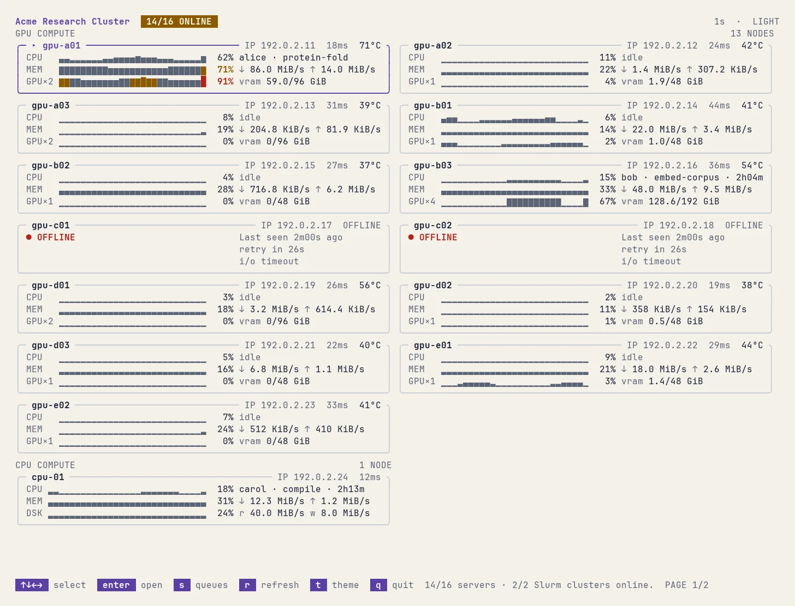

[English](README.md) | 简体中文

<div align="center">

# Fleetty

面向本机、GPU 节点、存储服务器与 Slurm 集群的 SSH 终端监控工具。

[](https://github.com/Rhythmicc/Fleetty/actions/workflows/ci.yml)
[](https://github.com/Rhythmicc/Fleetty/releases/latest)
[](go.mod)
[](LICENSE)
[](https://goreportcard.com/report/github.com/Rhythmicc/fleetty)

</div>

<a href="docs/images/fleetty-hub.webp">
  
</a>

<table>
  <tr>
    <td width="50%" valign="top">
      <strong>深色主题</strong> · 按 <code>t</code> 切换<br><br>
      <a href="docs/images/fleetty-hub.webp">
        
      </a>
    </td>
    <td width="50%" valign="top">
      <strong>浅色主题</strong> · 自动跟随终端外观<br><br>
      <a href="docs/images/fleetty-hub-light.webp">
        
      </a>
    </td>
  </tr>
  <tr>
    <td width="50%" valign="top">
      <strong>GPU 节点</strong> · GPU、Slurm 队列与进程<br><br>
      <a href="docs/images/fleetty-gpu.webp">
        
      </a>
    </td>
    <td width="50%" valign="top">
      <strong>存储节点</strong> · 挂载点、Docker、PM2 与 HTTP<br><br>
      <a href="docs/images/fleetty-nas.webp">
        
      </a>
    </td>
  </tr>
</table>

## 安装

```bash
curl -fsSL https://raw.githubusercontent.com/Rhythmicc/Fleetty/main/install.sh | sh
```

`go install`、[Releases](https://github.com/Rhythmicc/Fleetty/releases) 预编译包及 `FLEETTY_VERSION` / `FLEETTY_INSTALL_DIR` 变量说明见 [安装与升级](docs/zh-CN/installation.md)。

## 快速开始

```bash
fleetty top                        # local monitor (Linux & macOS, no root)
ssh -p 23234 monitor@node.example  # remote SSH node
ssh -p 23235 monitor@hub.example   # multi-server Hub
```

在 Linux 上部署 SSH 节点或 Hub 见 [安装 Linux 节点](docs/zh-CN/installation.md#linux-ssh-节点) 与 [配置 Hub](docs/zh-CN/hub.md)。

## 快捷键

| 按键 | 功能 |
| --- | --- |
| `1` / `2` / `3` / `4` | Overview / Compute / Network / 本地存储地图 |
| `Tab` / `Shift+Tab` | 下一页 / 上一页 |
| `↑` / `↓`、`Enter`、`Esc` | 选择 / 打开详情或节点 / 返回 |
| `/` / `c` | 过滤进程 / 清除过滤 |
| `o` / `O` | 下一个排序列 / 反转排序方向 |
| `l` / `m` / `t` | 布局编辑器 / 管理模式 / 切换深色与浅色主题 |
| `s` / `r` / `q` | Slurm 队列（Hub 端）/ 刷新 / 退出 |

## 文档

- [安装与升级](docs/zh-CN/installation.md) — 系统要求、`install.sh`、`go install`、Linux SSH 节点、`fleetty update` 与卸载
- [使用指南](docs/zh-CN/usage.md) — 页面导航、逐核 CPU（`f` / `v`）、网络连接、本地存储地图（`d` / `z` / `u`）与自定义布局
- [Ghostty 与主题](docs/zh-CN/themes.md) — 深浅色自动跟随、Ghostty 配色与 Powerlevel10k 提示符配色
- [Hub](docs/zh-CN/hub.md) — `nodes.json` 分组、持久 SSH RPC 密钥与多服务器导航
- [Slurm](docs/zh-CN/slurm.md) — 本机与 SSH 登录节点传输、`NEXT` 候选、QOS 与窄屏队列
- [NAS 与服务监控](docs/zh-CN/nas.md) — `machine.json`、物理网卡、挂载点、Docker、PM2 与 HTTP 检查
- [部署与运维](docs/zh-CN/deployment.md) — `fleettyctl`、fleet manifest、Hub 级联更新、Prometheus 与 JSON 导出
- [认证与管理](docs/zh-CN/security.md) — `ADMIN_PASSWORD_HASH`、只读脱敏与特权助手 socket
- [配置与故障排查](docs/zh-CN/configuration.md) — 用户与系统路径、环境变量、systemd 日志与故障排查
- [采集与性能](docs/zh-CN/performance.md) — 采样间隔、SSH 连接复用与 7 天 `history.jsonl` 保留

## 参与贡献

欢迎报告问题与提交拉取请求，详见 [CONTRIBUTING.zh-CN.md](CONTRIBUTING.zh-CN.md)。

## 许可证

[MIT](LICENSE)
