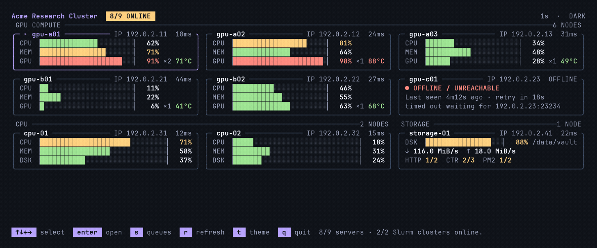

English | [简体中文](../zh-CN/themes.md)

[Back to the README](../../README.md)

# Ghostty and themes

[Ghostty](https://ghostty.org/) is the terminal we recommend, for a local session and for an SSH session. Its light and dark switch follows the system and drives Fleetty's automatic theme. You do not forward a theme variable to the server.

The repository includes [Fleetty Dark](../../themes/ghostty/Fleetty%20Dark) and [Fleetty Light](../../themes/ghostty/Fleetty%20Light). Dark is a charcoal background with soft bright colors. Light is warm paper with dark accents, and the cursor is black.

Install the themes on the client. The server does not need them:

```bash
fleetty_theme_dir="${XDG_CONFIG_HOME:-$HOME/.config}/ghostty/themes"
mkdir -p "$fleetty_theme_dir"
curl -fL "https://github.com/Rhythmicc/Fleetty/releases/latest/download/Fleetty-Dark.ghostty" \
  -o "$fleetty_theme_dir/Fleetty Dark"
curl -fL "https://github.com/Rhythmicc/Fleetty/releases/latest/download/Fleetty-Light.ghostty" \
  -o "$fleetty_theme_dir/Fleetty Light"
```

Replace Ghostty's `theme` setting with:

```ini
theme = dark:Fleetty Dark,light:Fleetty Light
```

Reload Ghostty and the terminal [follows the system appearance](https://ghostty.org/docs/features/theme#separate-light-and-dark-themes). The terminal theme colors the shell and the palette. Fleetty colors the monitor.

Set `background-opacity = 1` if you want contrast to stay put. A transparent background picks up whatever is behind the window. The theme files are colors only. They do not change fonts, keybindings, or opacity. Other terminals can run Fleetty. Automatic following depends on the terminal reporting light and dark. If it does not, press `t`.

## Automatic theme

`fleetty top` defaults to `--theme auto`. At startup it reads the terminal background and the light/dark report, and it subscribes to changes while it is running. An SSH connection straight to Fleetty's monitor port does the same from the client terminal. No environment variable is forwarded. `--theme dark`, `--theme light`, or `DEFAULT_THEME=dark` or `light` pins the palette. After `t`, this session is manual and no longer follows the system. A terminal that does not answer the query starts dark, and `t` still switches it.



The demo screenshots in `docs/images/` are rendered from the real TUI using a fictional fleet and can be regenerated with `sh docs/demo/render.sh`.

## Powerlevel10k

A Python or Conda segment on a blue background needs light text. Do not keep a dark foreground there. This goes in `~/.p10k.zsh` and suits both Fleetty themes:

```zsh
typeset -g POWERLEVEL9K_OS_ICON_FOREGROUND=7
typeset -g POWERLEVEL9K_OS_ICON_BACKGROUND=0
typeset -g POWERLEVEL9K_DIR_FOREGROUND=254
typeset -g POWERLEVEL9K_VIRTUALENV_FOREGROUND=254
typeset -g POWERLEVEL9K_ANACONDA_FOREGROUND=254
typeset -g POWERLEVEL9K_PYENV_FOREGROUND=254
```

In the dark theme, the ordinary blue is for a dark blue background and the bright blue is for text. Do not set both to the same light blue. After a Ghostty theme change, reload the terminal configuration (on macOS the default is `⌘⇧,`). After a prompt change, run `source ~/.p10k.zsh`.
