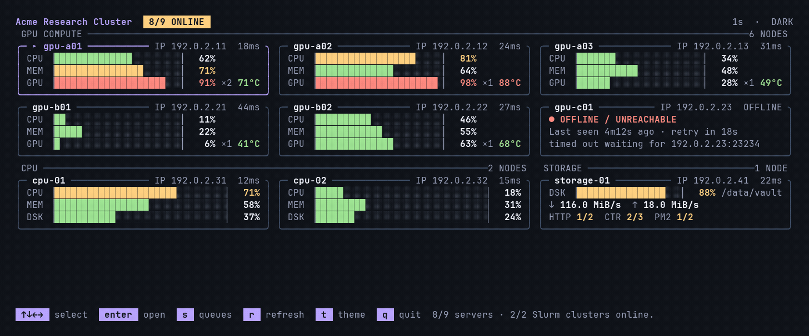

[English](../en/themes.md) | 简体中文

[返回 README](../../README.zh-CN.md)

# Ghostty 与主题

[Ghostty](https://ghostty.org/) 是我们建议使用的终端，本地会话和 SSH 会话都适用。它的深浅色切换跟随系统，并驱动 Fleetty 的自动主题。不必把主题变量转发到服务器。

仓库包含 [Fleetty Dark](../../themes/ghostty/Fleetty%20Dark) 和 [Fleetty Light](../../themes/ghostty/Fleetty%20Light)。深色是炭黑背景和柔和的亮色。浅色是暖纸背景和深色强调，光标为黑色。

在客户端安装主题。服务器不需要它们：

```bash
fleetty_theme_dir="${XDG_CONFIG_HOME:-$HOME/.config}/ghostty/themes"
mkdir -p "$fleetty_theme_dir"
curl -fL "https://github.com/Rhythmicc/Fleetty/releases/latest/download/Fleetty-Dark.ghostty" \
  -o "$fleetty_theme_dir/Fleetty Dark"
curl -fL "https://github.com/Rhythmicc/Fleetty/releases/latest/download/Fleetty-Light.ghostty" \
  -o "$fleetty_theme_dir/Fleetty Light"
```

把 Ghostty 的 `theme` 换成：

```ini
theme = dark:Fleetty Dark,light:Fleetty Light
```

重新加载 Ghostty 后，终端会[跟随系统外观](https://ghostty.org/docs/features/theme#separate-light-and-dark-themes)。终端主题给 shell 和色板上色。Fleetty 给监控界面上色。

如果希望对比度保持稳定，设置 `background-opacity = 1`。透明背景会带上窗口后面的内容。主题文件只有颜色。它们不改字体、快捷键或透明度。其他终端也可以运行 Fleetty。自动跟随取决于终端是否报告深浅色。如果不报告，按 `t`。

## 自动主题

`fleetty top` 默认是 `--theme auto`。启动时读取终端背景和深浅色报告，并在运行中订阅变化。直接 SSH 到 Fleetty 监控端口时，同样根据客户端终端决定。不转发环境变量。`--theme dark`、`--theme light`，或 `DEFAULT_THEME=dark` / `light`，会固定配色。按过 `t` 之后，这个会话改为手动，不再跟随系统。不回答查询的终端从深色开始，`t` 仍然可以切换。



`docs/images/` 中的演示截图由真实 TUI 使用虚构集群数据生成，可通过 `sh docs/demo/render.sh` 重新生成。

## Powerlevel10k

蓝底上的 Python 或 Conda 段需要浅色文字。不要在那里保留深色前景。下面的内容放进 `~/.p10k.zsh`，两种 Fleetty 主题都适用：

```zsh
typeset -g POWERLEVEL9K_OS_ICON_FOREGROUND=7
typeset -g POWERLEVEL9K_OS_ICON_BACKGROUND=0
typeset -g POWERLEVEL9K_DIR_FOREGROUND=254
typeset -g POWERLEVEL9K_VIRTUALENV_FOREGROUND=254
typeset -g POWERLEVEL9K_ANACONDA_FOREGROUND=254
typeset -g POWERLEVEL9K_PYENV_FOREGROUND=254
```

在深色主题里，普通蓝用于深蓝背景，亮蓝用于文字。不要把两者设成同一个浅蓝。改完 Ghostty 主题后重新加载终端配置（macOS 默认是 `⌘⇧,`）。改完 prompt 后执行 `source ~/.p10k.zsh`。
